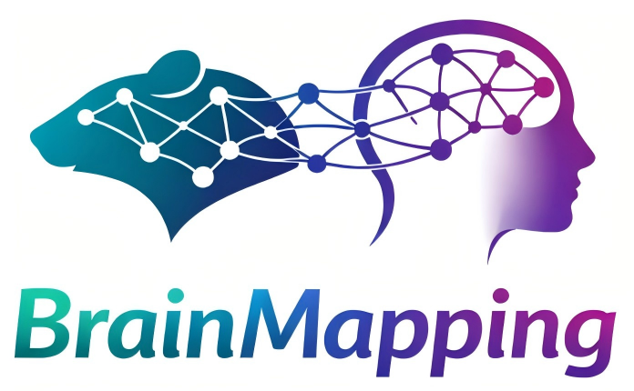
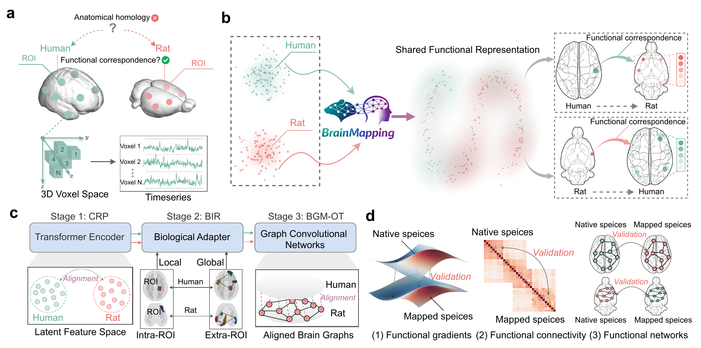

  

<h1 align="center">Biologically inspired alignment reveals distributed and directionally asymmetric correspondence between rat and human cortices</h1>

  Xingbo Dong, Qiang Luo, Aoling Cai, Zhe Jin, Chaoxu Mu, Fei Wang, Hongming Shan

  
  

  

**BrainMapping** uses resting-state fMRI to study how rat and human cortical regions relate through their functional organization. It learns a shared representation and a probabilistic, many-to-many map, without predefined cross-species ROI matches.

We evaluate the maps in held-out subjects by asking whether they preserve functional connectivity, cortical gradients and graph topology. Preservation differs by direction: human-to-rat mapping is more uniform across rat cortical systems, while rat-to-human mapping better preserves human association-related networks than primary sensory and motor networks.

## Main Findings

- Fixed maps estimated from training subjects preserve several aspects of functional organization in held-out subjects.
- Rat-to-human FC preservation is stronger in default-mode, dorsal-attention and salience/ventral-attention networks than in visual and somatomotor networks.
- The maps recover literature-consistent default-mode and salience-system relationships, alongside non-canonical correspondences that can be tested in future studies.

These are functional correspondences, not established anatomical homologues. Acquisition conditions, parcellation and the directional training objectives may also contribute to the observed asymmetry.

## Method

BrainMapping has three stages:

1. **Cross-Species Representation Pretraining (CRP).** A shared Transformer encodes voxel-wise ROI time series. Angular-margin supervision separates within-species ROI representations.
2. **Biology-Informed Representation Refinement (BIR).** With the encoder frozen, BYOL-style learning matches representations from masked views of the same ROI. A classification objective uses within-species network or cortical-system labels to retain functional organization.
3. **Bidirectional Graph Matching via Optimal Transport (BGM-OT).** A shared GCN processes species-specific feature graphs. Sinkhorn optimal transport estimates the correspondence, with feature alignment, topology alignment and cycle-consistency objectives.

The final transport plan is estimated from training subjects only and fixed before held-out evaluation. The map supports both directions; feature and topology alignment are trained in the human-to-rat direction, with a human-to-rat-to-human cycle.

## Data

| | Human | Rat |
|---|---|---|
| Data | HCP 1200 Subjects, 3T `rfMRI-REST1` | 7T rs-fMRI, anesthetized male Sprague-Dawley rats |
| Subjects | 72 (57 training / 15 held-out) | 54 (43 training / 11 held-out) |
| Atlas | Schaefer 100-parcel, 7-network atlas | SIGMA atlas |
| Network / system labels | Seven functional networks | Frontal, parietal, occipital and temporal systems |

ROI definitions and system assignments are listed in Supplementary Tables S1-S2. Human subject IDs and demographics are provided in Table S3.

## Interactive Exploration

The [BrainMapping platform](http://www.brmapping.com) lets users select a source ROI and explore its cross-species similarity profile.

Supplementary Figs. S1-S4 show examples in both directions, including human frontal opercular/insular and orbitofrontal seeds, and rat orbitofrontal and agranular insular seeds. Tables S4-S5 report the top five targets for selected seeds using cosine similarity.

## Code and Models

Code, pretrained weights and usage instructions will be released after publication.

## Citation

Publication details and BibTeX will be added when available.

> Xingbo Dong, Qiang Luo, Aoling Cai, Zhe Jin, Chaoxu Mu, Fei Wang, and Hongming Shan. *Biologically inspired alignment reveals distributed and directionally asymmetric correspondence between rat and human cortices.*

## License

This project is released under the [MIT License](LICENSE).
